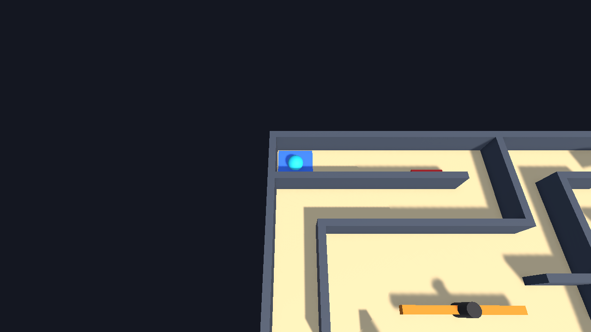
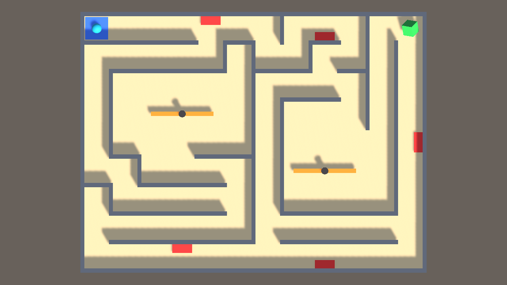
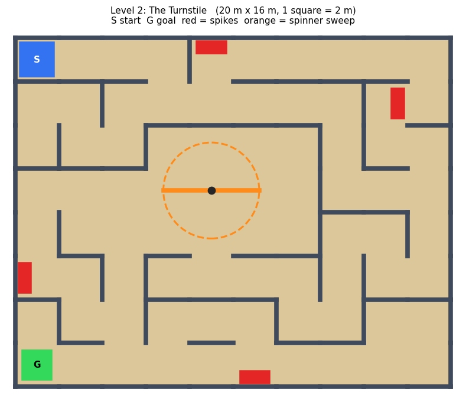

# Echo Maze: Game Design Document (Midterm)

| | |
|---|---|
| **Course** | DMVR504 Game Design and Development, ESLSCA University, Fall 2026 |
| **Instructors** | Adam Hassan Aboelfetouh, Arafa Taher |
| **Team** | Ahmed Abdelsalam, Mohamed Emad, Omar Wael, Omar Jawad |
| **Submission date** | 1 November 2026 |
| **Prototype** | https://github.com/seehaman/EchoMaze (Unity 6000.3.8f1, open `Assets/Scenes/Level1`) |

---

## 1. Game concept and pitch

**Working title:** Echo Maze
**Genre:** Top-down puzzle-action maze

**One-sentence pitch:** A rolling-ball maze where every failed run comes back as a ghost, and touching your past self costs a life.

**Overview.** The player rolls a ball through a hand-built maze to reach a green goal. Spikes and spinning arms
block the way. Dying is not just a penalty. The run that failed is recorded and replays on a loop as a violet
**Echo**. Echoes wake 2 seconds after the player respawns and follow the old path exactly. Every mistake therefore
changes the level. The more you fail, the more crowded the maze becomes. You have to remember where your Echoes go
and pick routes and timing that avoid both the hazards and your own past.

**Distinctive hook (USP).** The player's own failures become the level's moving obstacles. Most games reset the
level after a death. Echo Maze keeps a trace of every attempt, so the difficulty depends on how the player played.

**Theme, setting and role.** The player is a small glowing orb trapped in a maze that "remembers". The setting is
abstract and graybox for the midterm: sand floor, slate walls, and bright colours that mark meaning (red = danger,
green = goal, violet = your past).

## 2. Target audience, platform and player goals

| | |
|---|---|
| **Target audience** | Players aged 12+ who enjoy short, replayable skill puzzles (fans of *Super Meat Boy*, *The World's Hardest Game*). Sessions of 5–15 minutes. |
| **Platform** | PC (Windows / macOS), keyboard. Built in Unity 6. |
| **Player goal** | Reach the green goal in each of the 3 levels. |
| **Win condition** | Touch the goal → "LEVEL COMPLETE". Clearing Level 3 → "YOU ESCAPED THE ECHO MAZE!". |
| **Lose condition** | Lose all 5 lives in a level → "GAME OVER", press R to retry the level. |
| **Main challenge** | Moving a ball that has momentum through tight corridors while timing spinners and avoiding up to 3 Echoes replaying your earlier failures. |

**Scope statement.**

- *Midterm prototype (done):* movement, collisions, spikes, spinners, Echo recording/replay, lives, win/lose,
  restart, 3 levels, HUD messages.

- *Final version (planned):* sound and music, Echoes that can press switches and open doors (turning failures into
  tools), best-time / fewest-deaths records, a main menu, 2–3 more levels.

- *Left out:* enemies with AI, story cutscenes, multiplayer, online leaderboards, 3D art. These are outside the
  scope of a one-semester project.

## 3. Game design principles

### 3.1 Clear goals and rules
| | |
|---|---|
| **Design decision** | Each level opens with a message: level name + one-line tip + "Press SPACE to start" (e.g. *"Dying is allowed. Every failed run comes back as an Echo."*). The goal is a bright green spinning cube, the only green object. |
| **Effect on the player** | The player knows what to do (reach green) and the one new rule (deaths create Echoes) before moving. |
| **How to test** | Ask playtesters right after Level 1: "What was the goal? What happens when you die?" Success = they answer correctly without help. |

### 3.2 Feedback and responsiveness
| | |
|---|---|
| **Design decision** | On death the ball disappears, the game pauses 1 second, and a message names the cause: *"You rolled onto the spikes!"*, *"The spinner hit you!"*, *"Your own Echo caught you!"*, followed by *"That run is now an Echo."* The HUD updates **Lives** and **Echoes: x / 3** at once. Echoes **flicker** for 0.5 s before they start moving. |
| **Effect on the player** | Every death is readable. The player learns what killed them and that the game has changed. The flicker warns them before an Echo becomes dangerous. |
| **How to test** | Watch playtesters. After each death, ask "What killed you?" Count how often they answer wrongly or say "I don't know why I died". |

### 3.3 Challenge, difficulty and progression
| | |
|---|---|
| **Design decision** | The levels grow in size and in danger. **Level 1** (16 × 12 m): 11 inner walls, 3 spikes, 1 spinner at 50°/s. **Level 2** (20 × 16 m): 29 inner walls, 4 spikes, 1 spinner at 60°/s placed on the only route. **Level 3** (24 × 18 m): 25 inner walls, 5 spikes, 2 spinners at 75°/s spinning opposite ways. |
| **Effect on the player** | Level 1 teaches the spinner and the Echo rule in a small space. Later levels demand longer memory and tighter timing. |
| **How to test** | Record deaths per level for each tester. Expect deaths to rise gently (e.g. 1–2, 2–3, 3–4). A jump to 5 (Game Over) on Level 2 would mean the difficulty curve is too steep. |

### 3.4 Meaningful player choices and agency
| | |
|---|---|
| **Design decision** | Level 3 has two routes to the goal. The **short route (~46 m)** crosses both spinner rooms. The **long route (~66 m)** avoids the spinners but runs past three spike strips that leave only a narrow gap. Spikes cover only one side of a corridor, so the player chooses how close to steer. The player also chooses *when* to die: a death on a busy route leaves an Echo that will block that route later. |
| **Effect on the player** | Players weigh risk against distance, and their own play shapes the difficulty. |
| **How to test** | Log which route each tester takes in Level 3 and ask why. If everyone takes the same route, the other route needs rebalancing. |

### 3.5 Balance and fairness
| | |
|---|---|
| **Design decision** | Echoes are harmless (no collider) and invisible for 2 s after a respawn, then flicker for 0.5 s. Only the **3 newest** Echoes exist. Very short runs (died almost instantly) do not create an Echo. 5 lives per level. |
| **Effect on the player** | The game never kills the player the instant they respawn. A bad streak cannot fill the maze with ghosts. Frustration stays capped. |
| **How to test** | Ask "Did any death feel unfair?" and note when. Check whether any tester is caught by an Echo while it is still flickering, which would mean the warning is too short. |

## 4. MDA framework analysis

**Target aesthetics:** *Challenge* (mastering timing and movement), *Discovery* (learning how your own Echoes move),
and a light *Narrative/Fantasy* of being haunted by your past attempts.

| Mechanics (rules we built) | Dynamics (what players do) | Aesthetics (what players feel) |
|---|---|---|
| **M1.** Every death records the run (one position per physics step) and replays it on a loop as an Echo. Touching a moving Echo costs a life. | Players **remember and predict** Echo paths, wait for an Echo to pass, or deliberately take a different corridor. Some players **die on purpose** in a harmless spot to keep the Echo away from the main route. | **Challenge** and **Discovery**: "I'm being chased by myself". A feeling of ownership, because the obstacles are your own history. |
| **M2.** Echoes wake 2 s after respawn, flicker 0.5 s, then move. Max 3 Echoes; the oldest is deleted. | Players **rush** away from the start in the first 2 seconds, which creates urgency and **risk-taking**. They also learn that more failures replace old Echoes, so they manage them. | **Tension**, then **relief**, while staying **fair**. The pressure never becomes hopeless. |
| **M3.** Ball moves with `Rigidbody.AddForce`, so it has momentum. Spinner arms rotate at a constant speed (Rotator). Spikes cover half a corridor. | Players **slow down** before spinner rooms, **watch the arm's rhythm**, then commit. They **steer carefully** past spike strips. | **Challenge / mastery**: a satisfying moment when you roll through a gap at the right moment. |
| **M4.** 5 lives per level; R restarts instantly; SPACE moves on after a win. | Players **retry quickly** and experiment without long punishment. | **Motivation** to try again ("one more go"). |

**Why these mechanics should produce the aesthetics.** M1 turns every failure into new content, so players explore
how their own movement interacts with the maze (Discovery). M2 and M3 together create timing decisions under mild
time pressure (Challenge). M2's limits and M4's fast restart keep that pressure from turning into frustration, which
is what keeps players in the loop. The three columns are linked: the Echo rule (M) creates prediction and route
planning (D), which creates the feeling of being chased by yourself (A).

## 5. Core gameplay loop and game flow

**Core loop**

```
   ┌──────────────────────────────────────────────────────────────┐
   ▼                                                              │
 Read the maze ──► Roll toward the goal ──► Time spinners / avoid spikes & Echoes
                                                │                │
                                    success ◄───┘                └──► failure
                                       │                               │
                         Level complete, next level        Lose a life + run becomes an Echo
                                                                       │
                                                         Respawn, Echoes wait 2 s ───┘ (repeat)
```

The player repeatedly plans a route, executes it with careful movement, and either reaches the goal or dies. Each
death changes the level by adding an Echo, so the next attempt is a new puzzle. That is why players want to continue.

**Game flow**

1. **Start / onboarding:** Level 1 opens with its title, a one-line tip and "Press SPACE to start". The ball starts on a blue pad.
2. **Main gameplay:** roll through the maze; lives and Echo count are shown at the top-left.
3. **Failure:** hit spikes, a spinner or an Echo → message + 1 s pause → respawn at start; Echoes restart their runs.
   At 0 lives → "GAME OVER – Press R to try again".

4. **Success:** touch the goal → "LEVEL COMPLETE – Press SPACE for the next level". After Level 3 → "YOU ESCAPED THE ECHO MAZE! – Press SPACE to play again".
5. **Restart:** R restarts the current level at any time.

**Player actions and controls**

| Input | Action |
|---|---|
| W A S D / Arrow keys | Roll the ball (force-based movement with momentum) |
| SPACE | Start level / next level / play again |
| R | Restart current level |

## 6. Prototype overview

- **Engine:** Unity 6000.3.8f1, Universal Render Pipeline, new Input System.
- **How it was built:** every level is assembled by hand in the Unity Editor. Walls are scaled Cubes under
  `Maze/OuterWalls` and `Maze/InnerWalls`, and hazards are prefabs placed under `Hazards`. These follow the course's
  Roll a Ball lectures (Week 4: player, camera, rotator; Week 5: walls, materials, prefabs). No code generates the
  level. Details: `Docs/BUILD_GUIDE.md`.

- **Scripts (5):** `PlayerController` (movement + run recording + trigger detection), `CameraController` (follow camera),
  `Rotator` (spinners and goal), `EchoGhost` (replays a recorded run), `GameManager` (lives, Echoes, HUD, win/lose, levels).

- **How to run:** see `README.md`. Open `Assets/Scenes/Level1`, press Play, press SPACE.

**Screenshots and maps** (`Docs/Screenshots`, `Docs/LevelMaps`)

| Level 1 (player view) | Level 3 (top view) |
|---|---|
|  |  |



## 7. Visual design evidence

- **Level layouts:** top-down maps of all three levels in `Docs/LevelMaps/`. They were drawn first on a 2 m grid and
  then built wall-by-wall in the editor.

- **HUD mock-up:**

```
┌──────────────────────────────────────────────────────────┐
│ Lives: 5                                                 │
│ Echoes: 1 / 3                                            │
│                                                          │
│                Level 2: The Turnstile                    │
│   Echoes loop forever. Learn their paths before you cross│
│                  Press SPACE to start                    │
│                                                          │
└──────────────────────────────────────────────────────────┘
```

- **Colour language:** blue = start, green = goal, red = spikes, orange = spinner arm, violet = Echo (your past),
  cyan = you.

- **Inspiration (ideas only, nothing copied):** *Mario Kart* time-trial ghosts (racing your own replay);
  *Super Meat Boy* (seeing past attempts, instant retry); *The World's Hardest Game* (top-down timing past moving
  hazards). We borrow the *idea* of replaying the player's own attempts, but here they are obstacles, not a racing
  reference.

## 8. Playtesting and reflection

**Questions we ask playtesters**

1. Was the goal clear from the first screen? What did you think an Echo was?
2. When you died, did you know what killed you?
3. In Level 3, which route did you take, and why?
4. Did any death feel unfair?

For each tester we record the level reached, deaths per level, the Level 3 route taken, and any comments.
The written playtest log will be added to the repository before the final submission.

**Observations from development testing**

1. *Level 2 offered no real choice.* When we measured the routes, the "safe" route around the spinner was exactly as
   short as the route through it (38 m each), so the spinner never mattered. We redesigned the level's walls so the
   spinner room sits on the only path. That gives Level 2 a timing challenge, and the risk-versus-distance route
   choice now lives in Level 3 (≈46 m past both spinners versus ≈66 m past three spike strips).

2. *Echoes catch idle players.* If the player waits on the start pad after respawning, their newest Echo wakes up
   there 2 seconds later and costs a life. We kept this on purpose because it creates urgency, and we added the
   0.5-second flicker so it is never a surprise.

3. *A rotation bug.* Our tests found that the tilted goal cube's rotation was saved with too little precision, and
   Unity reported an invalid rotation. We fixed it before submission.

**Reflection**

- *One thing that worked:* the Echo rule is easy to understand from one death message ("That run is now an Echo"),
  and it immediately changes how carefully the player moves.

- *One problem:* Level 2's original layout gave the player no meaningful choice (observation 1).
- *One change we plan to make:* tune ball speed and damping, and the Echo wake delay, based on human playtest
  results. Testers who struggle with the ball's momentum will tell us whether it needs to be easier to control.

**Developer testing done so far.** Automated play-mode tests in Unity checked the following on all three levels:

- each level loads with its HUD,
- the ball cannot pass through walls,
- spikes, spinner arms and Echoes each cost a life,
- an Echo is created on death, stays harmless while waiting, then replays the run,
- touching the goal shows the level-complete / victory message,
- 5 deaths give Game Over, with never more than 3 Echoes.

These tests check that the game works. They do **not** replace playtesting with real people.

## 9. Work completed, remaining tasks and end-of-term plan

| Area | Done (midterm) | Remaining (final) |
|---|---|---|
| Core movement and collisions | ✔ | Tune speed and damping from playtest feedback |
| Hazards | ✔ spikes, spinners | Moving spikes, doors |
| Echo system | ✔ record, replay, wake delay, flicker, max 3 | Echoes press switches / open doors |
| Levels | ✔ 3 levels | 2–3 more levels, main menu |
| Feedback | ✔ HUD and messages | Sound effects, music, death particles |
| Replayability | ✔ | Best time and fewest deaths per level |
| Documentation | ✔ GDD, README, build guide | Final GDD, gameplay video, presentation |

**Team:** Ahmed Abdelsalam, Mohamed Emad, Omar Wael, Omar Jawad.

## 10. References and credits

- Course lectures, DMVR504 (Moodle): CH1 Intro; Get Started with the Unity Editor; CH2 MDA Framework;
  Lecture 4 Roll a Ball 1 (player, camera, rotator); Lecture 5 Roll a Ball 2 (play area, walls, collectibles, prefabs).

- Hunicke, R., LeBlanc, M., & Zubek, R. (2004). *MDA: A Formal Approach to Game Design and Game Research.*
- Unity Technologies. *Roll-a-Ball* tutorial, Unity Learn.
- Unity 6 (6000.3.8f1), Universal Render Pipeline, Input System package.
- Inspiration: *Mario Kart* (Nintendo), *Super Meat Boy* (Team Meat), *The World's Hardest Game* (Snubby Land).
- All code, levels and materials are our team's own work. No third-party assets are used.
