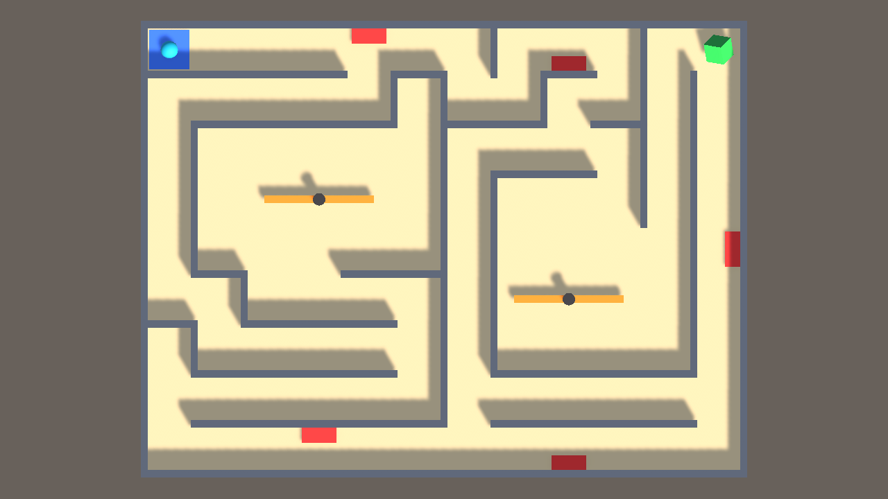

# Echo Maze

**Genre:** top-down puzzle-action maze · **Platform:** PC (Unity 6) · **Course:** DMVR504 Game Design and Development, ESLSCA University

> Roll through a maze where every failed run comes back as a ghost, and touching your past self costs a life.

Roll the ball to the green goal. Spikes and spinning arms cost a life. Each time you die, the run you just
made is recorded and replayed on a loop as an **Echo**. Echoes wake up 2 seconds after you respawn, so every mistake
becomes an obstacle you have to plan around.



---

## How to open and run

**Needs:** Unity **6000.3.8f1** (Unity 6), installed through Unity Hub. Any newer Unity 6 version also works;
Unity may offer to upgrade the project.

1. Download or clone this repository.
2. Open **Unity Hub → Projects → Add → Add project from disk**, and pick the `EchoMaze_Rebuild` folder
   (the folder that contains `Assets`, `Packages` and `ProjectSettings`).
3. Open the project. The first import takes a few minutes.
4. In the **Project** window, open `Assets/Scenes/Level1`.
5. Press **Play**, click the Game view, then press **SPACE** to start.

The game moves through Level1 → Level2 → Level3 on its own.

## Controls

| Key | Action |
|---|---|
| **W A S D** or **Arrow keys** | Roll the ball |
| **SPACE** | Start the level / go to the next level |
| **R** | Restart the current level |

## Rules

- Reach the **green goal** to clear the level. There are **3 levels**.
- **Red spikes** and **orange spinner arms** cost a life. You have **5 lives per level**. At 0 lives it is Game Over.
- Every death creates an **Echo** (violet ball) that replays your failed run, over and over.
- Echoes wait **2 seconds** after you respawn, **flicker** as a warning, then start moving. Touching a moving Echo costs a life.
- At most **3 Echoes** exist at once. The oldest disappears when a 4th is made.

## Project layout

```
Assets/
├── Scenes/      Level1, Level2, Level3 (every wall and object placed in the editor)
├── Scripts/     PlayerController, CameraController, Rotator, EchoGhost, GameManager
├── Prefabs/     Spikes, Spinner, Echo
├── Materials/   Ground, Walls, Player, Echo, Spikes, SpinnerArm, SpinnerPivot, Goal, StartPad
├── Settings/    URP render settings (from the Unity 6 template)
└── InputSystem_Actions.inputactions   default Unity input actions (Player → Move)
Docs/
├── GameDesignDocument.md   midterm design document (concept, principles, MDA, loop, playtesting)
├── BUILD_GUIDE.md          how each part was built in the editor + every object's Transform
├── LevelMaps/              top-down map of each level
└── Screenshots/            screenshots of each level
```

### How it is built

The levels are built by hand in the Unity Editor, using the techniques from the course lectures:

- **Walls** are Cubes with a Position and Scale, kept under empty parent objects (`Maze > OuterWalls / InnerWalls`)
  and copied with Duplicate, as in *Lecture 5: Setting up the Play Area*.
- **Spikes and spinners** are **prefabs** placed around the level, like the PickUp prefab in Lecture 5.
- **Movement** uses the Roll a Ball `PlayerController` (Player Input + `OnMove` + `Rigidbody.AddForce`).
- **Camera** uses the Roll a Ball `CameraController` (offset in `Start`, follow in `LateUpdate`).
- **Spinners and the goal** use the `Rotator` script.
- **Hazards and the goal** are detected with trigger colliders, `OnTriggerEnter` and tags.

No script creates or places the maze. See `Docs/BUILD_GUIDE.md` for step-by-step instructions and the exact
position and scale of every wall.

## Status

| Feature | Status |
|---|---|
| Ball movement, solid walls, follow camera | Done |
| Spikes and spinners (lose a life) | Done |
| Echo recording and looping replay | Done |
| Echo 2-second wake delay, warning flicker, max 3 Echoes | Done |
| Lives, Game Over, restart (R) | Done |
| 3 hand-built levels with rising difficulty | Done |
| On-screen lives, Echo count, level intro, death, level-complete and victory messages | Done |
| Sound effects and music | Planned (final) |
| Echoes that press switches / open doors | Planned (final) |
| Best time and fewest-deaths records | Planned (final) |
| Main menu and more levels | Planned (final) |

## Team

- Ahmed Abdelsalam
- Mohamed Emad
- Omar Wael
- Omar Jawad

## Credits

- All code, level layouts and materials were made by our team for this course.
- The movement, camera and rotator scripts are based on the course's Roll a Ball lectures (DMVR504, Weeks 4–5),
  which follow Unity Learn's *Roll-a-Ball* tutorial.
- Shapes are Unity's built-in primitives. `InputSystem_Actions` and the URP settings come from the Unity 6 project template.
- No third-party art, audio, code or asset-store packages are used.
- **Design inspiration (ideas only, nothing copied):**
  - *Mario Kart* time-trial ghosts: racing a replay of your own earlier run.
  - *Super Meat Boy*: replaying failed attempts; fast retries after death.
  - *The World's Hardest Game*: timing your way past moving hazards in a top-down layout.
- Built with [Unity](https://unity.com).
